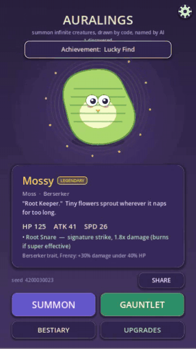
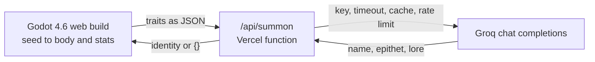

# Auralings

Godot 4.6 roguelite where code draws each creature from a seed and a Groq LLM writes its name and lore.



*Four summons in the Godot web build: the body is drawn from the seed, and the name, epithet and lore come from the language model (recorded locally with the model call answered by a stand-in).*

**Proof:** playable in the browser at https://auralings.vercel.app (a static Godot export; it answered HTTP 200 on 2026-10-17, and its `/api/summon` proxy returned a generated name, epithet and lore line for a test creature the same day). A 3,000 run balance simulation (`tools/BalanceSim.tscn`, run 2026-10-17) gives a median streak of 6 rounds for a fresh champion and 9 for a level 5 one; the simulation is unseeded, so the figures move by a round or so between runs.

## What it is and why

A creature collector where the model is never trusted with anything that has to be consistent. A seed decides the body and the stats in GDScript: 8 elements, 6 body shapes, 6 eye styles, 6 mouths, 5 horn styles, and four rarities weighted 70, 20, 8 and 2 percent. The language model only writes text for it: a name, a two or three word epithet, one line of lore and an ability name. If the model call fails, the creature still exists with a procedural name and the lore line reads "A wandering Ember spirit" (or "Its story is lost to static..." when a call comes back empty).

A run is called the Gauntlet. You summon a champion, fight escalating rounds with HP carried between fights, pick one boon after each win, and the run ends on your first loss. Between runs the best streak is saved, Essence buys three upgrades (Vigor, Might, Insight), 8 achievements unlock, and every creature you summon goes into a paged bestiary where you can pick any of them as your champion. Four battle roles (Warden, Berserker, Skirmisher, Adept) each come with one signature trait.

## What was hard

- **A model retired under a live game.** Groq retired `llama-3.3-70b-versatile` in early September 2026. The proxy kept answering `{}` by design, so the game ran on with no model text and nothing said so. Commit `44f9be0` makes the model a setting (`GROQ_MODEL`, default `openai/gpt-oss-120b`). That model reasons before it answers and the reasoning counts against `max_tokens`, so a small budget returned an empty message; the proxy now asks for `reasoning_effort: "low"` and 900 tokens.
- **A public endpoint anyone can hit.** `api/summon.js` holds the Groq key so the browser never sees it. It clamps every input string and number, aborts after 8 seconds, retries once on a 429 or 5xx, keeps a 500 entry cache keyed by the creature's traits, and allows a burst of 30 requests per IP refilling at 0.5 per second. Every failure returns `200 {}` so the game falls back instead of erroring.
- **Runs that wall at round one.** The enemy ramp was tuned against the simulator in `tools/balance_sim.gd`, which mirrors the combat math (type chart, 1.8x ability, charge, burn, speed order, role traits) rather than by feel (commit `3ab1cff`).

## Architecture



On the desktop the game skips the proxy and calls Groq directly with a key read from `secrets/groq_key.txt`, which is git-ignored.

## Run it

You need Godot 4.6. A Groq key is optional: without one the game plays fully, with procedural names and the one-line fallback lore.

```bash
git clone https://github.com/Exalt24/auralings
cd auralings
godot --path .        # or open project.godot in the Godot 4.6 editor and press F5
```

For model written names on the desktop, put a Groq key in `secrets/groq_key.txt` first. To host the web build with the proxy, deploy the repo to Vercel (it serves `public/` and runs `api/summon.js`) and set `GROQ_API_KEY`.

## Tests

```bash
godot --path . --headless res://tools/TestLogic.tscn
godot --path . --headless res://tools/BalanceSim.tscn
```

`TestLogic` runs the real Main scene and prints PASS or FAIL for six groups: upgrades carrying into a run, the effect of each boon, the end of a run returning to the summon screen, champion levelling across re-summons, the underdog Essence multiplier, and role and trait validity across 10 seeds. All six printed PASS on 2026-10-17; it takes about 3.5 minutes headless. `BalanceSim` runs 3,000 gauntlets in a few seconds and prints the streak distribution by role and rarity. There is no CI workflow.

## Limits and not done

- The model writes text only. Every ability is the same signature strike for 1.8x damage; the model just names it.
- A seed always draws the same body and stats, but the name and lore are generated at temperature 1.1, so the same seed can read differently on two summons.
- The proxy's cache and rate limit live in one warm serverless instance and reset on a cold start, so they are best effort.
- The balance figures come from a simulation of the combat rules, not from watching players.
- The only export preset is Web, built for a 720 by 1280 portrait viewport; there is no native build. The Godot web export in `public/` is committed so Vercel can serve it.

## Stack

Godot 4.6, GDScript, WebAssembly export, Node.js serverless function on Vercel, Groq API.

## License

MIT, see [LICENSE](LICENSE).
